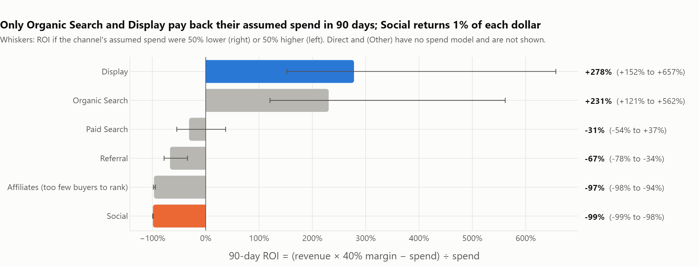

# Marketing campaign performance: GA360 sample

[](https://github.com/chua-yihin/marketing-campaign-performance/actions/workflows/ci.yml)

This project analyses 12 months of Google Analytics 360 data end to end: the funnel, CAC, ROI and 30/60/90-day retention for each acquiring channel. It ends with a recommendation on which channel to cut and which to scale.

> **Cut Social, scale Display: about +$120k in 90-day profit (+$60k to +$180k).**
> Social takes 66% of assumed spend but buys customers at $2,089 each, against $13 for Display. Cutting Social holds in 13 of 13 spend-sensitivity scenarios.

**[Read the 1-page memo](reports/memo.md)** · **[Open the interactive dashboard](https://chua-yihin.github.io/marketing-campaign-performance/)** · [Methodology](docs/methodology.md)



## What's inside

| Output | Where |
| --- | --- |
| Funnel by channel (visit → sign-up → purchase → repeat), Wilson 95% CIs | `reports/tables/funnel_by_channel.csv` |
| CAC, cost per new user, 90-day revenue per user, ROI, LTV:CAC | `reports/tables/economics_by_channel.csv` |
| 30/60/90-day retention with right-censoring | `reports/tables/retention_by_channel.csv` |
| ±50% spend sensitivity and cut/scale stability | `reports/tables/sensitivity*.csv` |
| Reallocation impact (low / base / high) | `reports/tables/reallocation_impact.csv` |
| The same cuts by top campaign | `reports/tables/*_by_campaign.csv` |
| Dashboard and charts | `docs/index.html`, `reports/figures/*.png` |

`make report` writes every number in the memo, the dashboard and this README from those tables. None are typed by hand.

## Data

- **Used:** `bigquery-public-data.google_analytics_sample.ga_sessions_*` (Google Merchandise Store, 2016-08-01 to 2017-08-01: 903,653 sessions, 714,167 users). The SQL in `sql/` reduces it to user-level extracts in `data/processed/*.parquet`, which are committed. Extract totals reconcile exactly with the source.
- **Considered and rejected:** the REES46 e-commerce dataset (Kaggle). It has no traffic source, channel or campaign column, so it cannot say which channel acquired a user.
- **Excluded:** Google's internal staff traffic, which arrives as Referral with source `(direct)`. Left in, it would make Referral look like the best channel, with ROI of +848% instead of -67%.

## Assumptions

The sample has no cost data, so **spend is assumed**. Every value is set in [`config/assumptions.yaml`](config/assumptions.yaml). To change one, edit it there and run `make all`. Nothing in the code needs to change.

| Channel | Assumed cost | Ranked |
| --- | --- | --- |
| Paid Search | $1.50 per new-user session | yes |
| Display | $0.80 per new-user session | yes |
| Affiliates | 10% of 90-day revenue + $0.20 per session | yes |
| Social | $0.60 per new-user session | yes |
| Organic Search | $3,000 per month, fixed | yes |
| Referral | $1,500 per month, fixed | yes |
| Direct | $0 (no spend model) | no |
| (Other) | $0 (no spend model) | no |
| Gross margin | 40% |  |
| Scale-up limit | scaled channel grows to at most 2x its spend, marginal CAC 30% worse |  |

## How to run

**Without Google Cloud.** This uses the committed parquet extracts:

```bash
git clone https://github.com/chua-yihin/marketing-campaign-performance.git
cd marketing-campaign-performance
uv sync
make all        # analyze -> report -> test
```

**With Google Cloud.** This reruns the BigQuery extraction:

```bash
gcloud auth application-default login
# set data.billing_project in config/assumptions.yaml
make extract    # dry-runs each query first and refuses anything over 20 GB (the full run is about 0.4 GB)
make all
```

## Method in one paragraph

Each user's first session (`visitNumber = 1`) sets their acquiring channel, i.e. first-touch attribution. Funnel and economics use users acquired at least 90 days before the data ends, so every user has a full 90-day window. Sign-up is proxied by `/registersuccess.html`. Guest checkout means it is not a gate before purchase, so CAC uses all purchasers. ROI = (90-day revenue × margin − spend) ÷ spend. Retention at day N counts only users with N days of data. Channels with fewer than 30 buyers are flagged and not ranked. See [docs/methodology.md](docs/methodology.md) for the details.

## Caveats

- Spend is assumed. The range above comes from ±50% changes to the cut and scale channels' spend.
- First-touch attribution may under-credit channels that assist later conversions.
- The data is from 2016-17 and covers a single store.

## References

These projects were reviewed for ideas and are credited in [docs/references.md](docs/references.md). This repo is built from scratch, not forked.

## License

MIT
